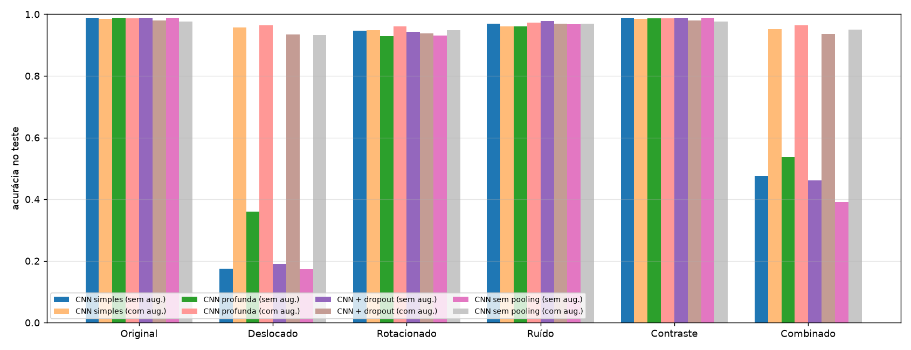

# As CNNs são realmente invariantes?

Estudo experimental, em PyTorch e MNIST, sobre a robustez de CNNs treinadas do zero a translações, rotações, ruído e mudanças de contraste. Compara 4 arquiteturas (simples, profunda, com dropout e sem pooling), cada uma treinada sem e com data augmentation.

📄 **Relatório completo:** [relatorio.md](relatorio.md)

## Integrantes

| Nome | RM |
|---|---|
| Vinicius Monteiro Araújo | 555088 |
| Guilherme Almeida | 555180 |
| Rafael Duarte de Freitas | 558644 |
| Rafael Gaspar Bragança Martins | 557228 |
| Luiz Gustavo da Silva | 558358 |

## Resultado principal

| Modelo | Original | Deslocado | Rotacionado | Ruído | Contraste | Combinado |
|---|---|---|---|---|---|---|
| CNN simples, sem aug. | 98,81% | **17,58%** | 94,58% | 97,00% | 98,80% | 47,59% |
| CNN simples, com aug. | 98,46% | 95,74% | 94,82% | 96,12% | 98,52% | 95,17% |
| CNN profunda, com aug. | 98,68% | 96,36% | 96,13% | 97,31% | 98,73% | 96,43% |

A convolução é equivariante a translações, mas a rede como um todo não é invariante: um deslocamento de 5 pixels derruba a acurácia para perto do acaso. O pooling dá apenas uma tolerância local, e o data augmentation dá robustez só dentro da faixa vista no treino. Tabela completa em [resultados/tabela_resultados.md](resultados/tabela_resultados.md).



## Estrutura

| Arquivo | Conteúdo |
|---|---|
| `mnist_cnn_invariancia_augmentation.py` | Script de apoio: dataloaders, transformações de treino/teste e CNN simples |
| `experimentos.py` | Modelos, treino, avaliação, varreduras de intensidade e figuras |
| `relatorio.md` | Relatório: metodologia, resultados, discussão e conclusão |
| `resultados/` | Tabelas, curvas, exemplos de acertos/erros, filtros, mapas de ativação e log |
| `enunciado_projeto_cnn_invariancia_mnist.docx` | Enunciado do projeto |

## Como executar

```bash
python -m venv .venv
.venv\Scripts\activate            # Windows (Linux/macOS: source .venv/bin/activate)
pip install torch torchvision matplotlib numpy

python experimentos.py                                # experimento completo (5 épocas por modelo)
python experimentos.py --epochs 1 --train-limit 1000  # teste rápido do pipeline
```

O MNIST é baixado automaticamente para `data/`. Os resultados são gravados em `resultados/`, e os pesos dos modelos em `resultados/modelos/`, pasta que não é versionada.
