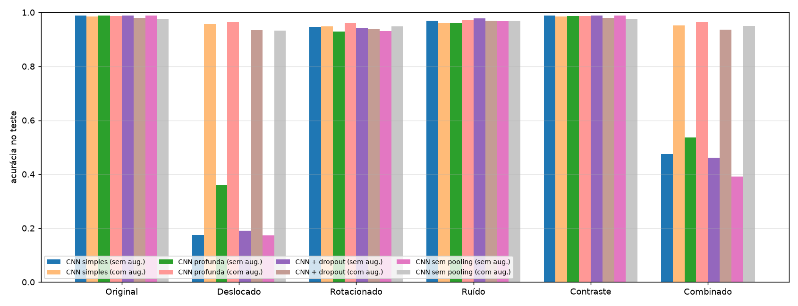
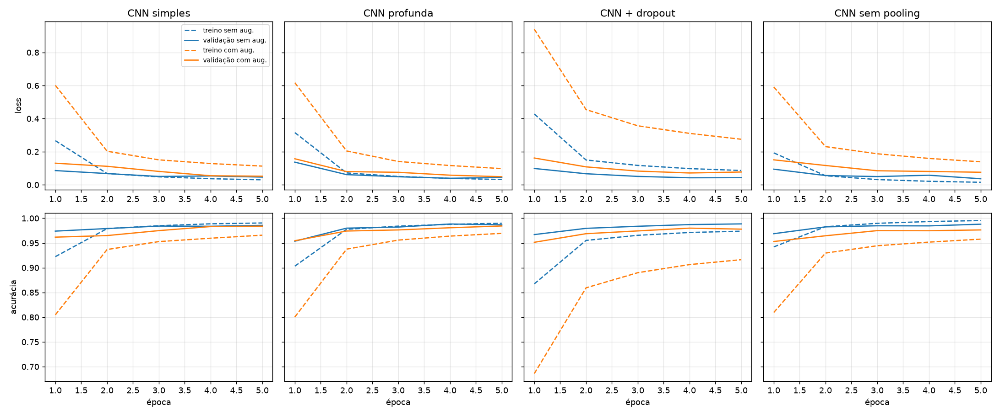
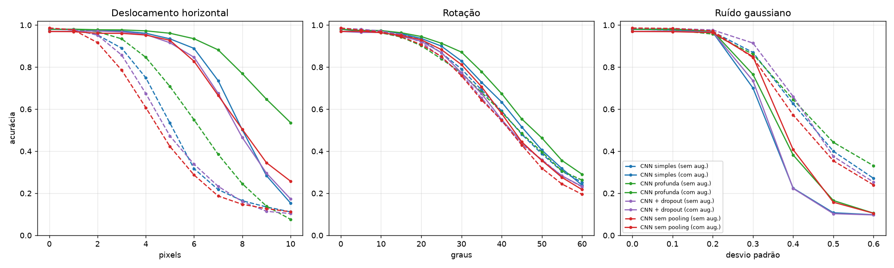
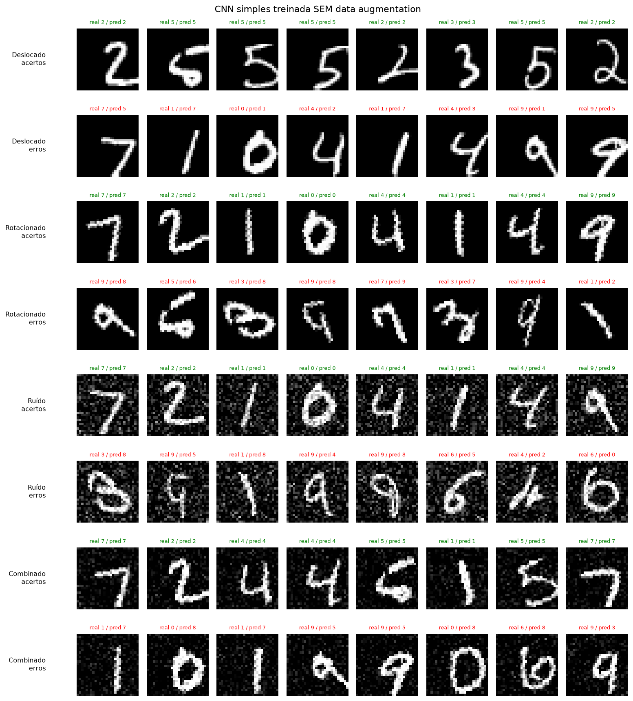
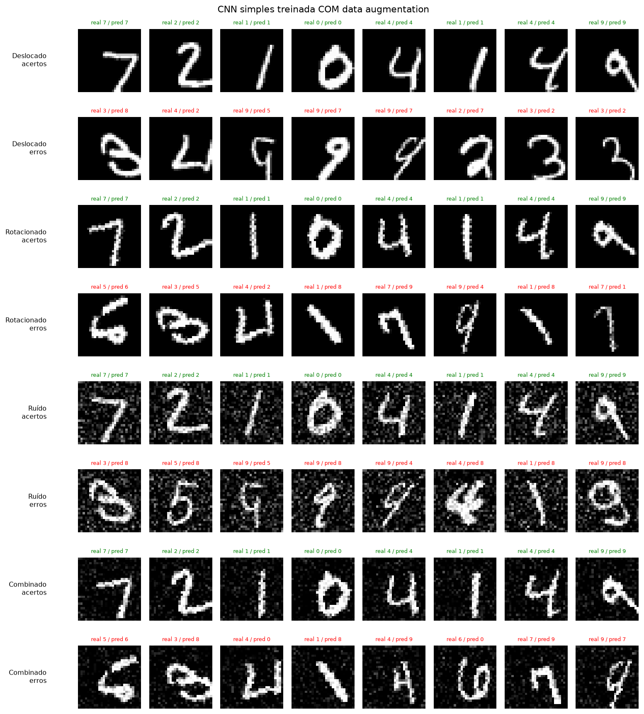
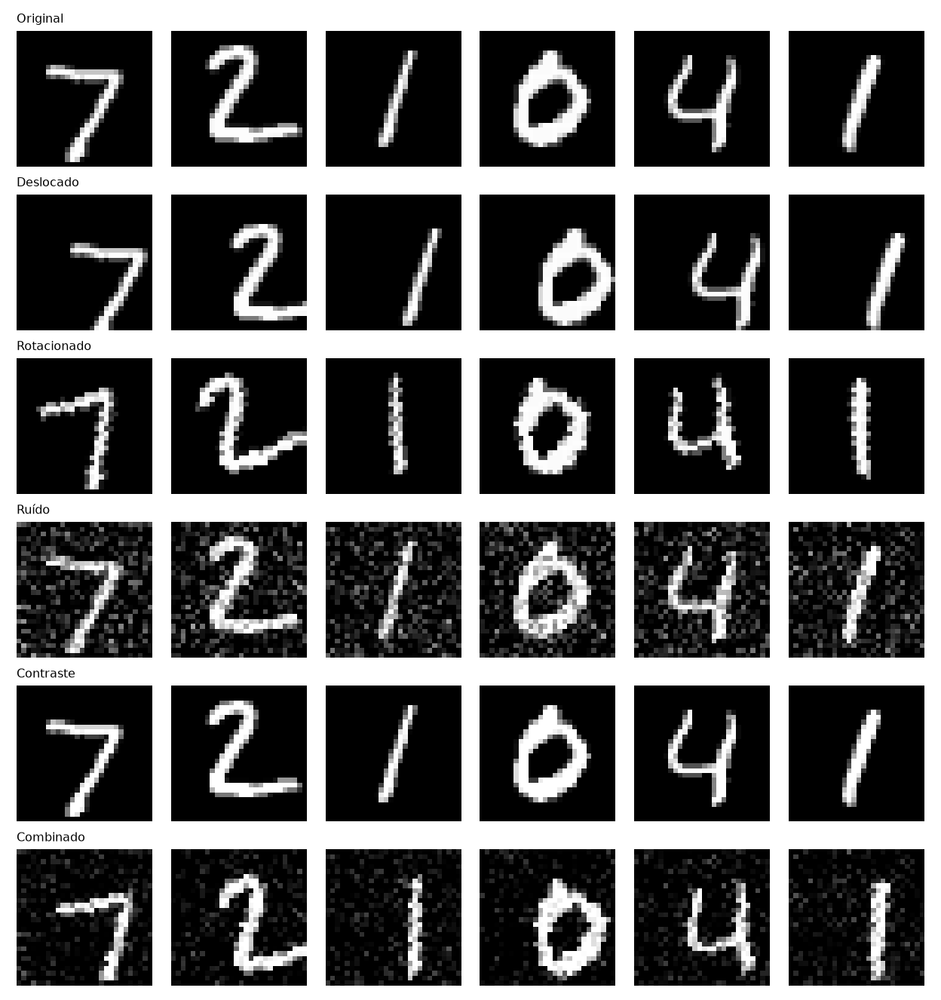
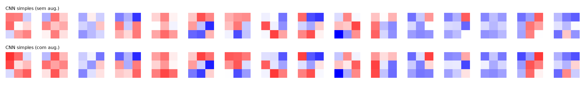
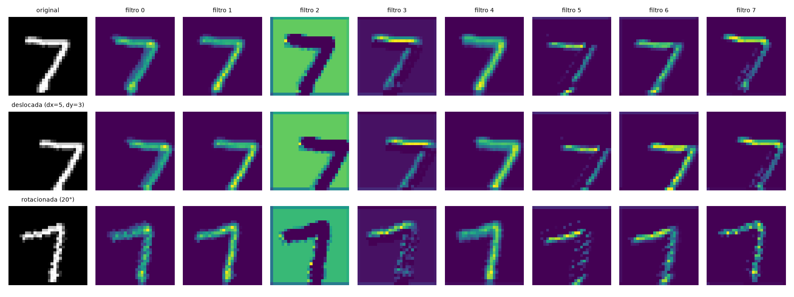

# As CNNs são realmente invariantes?
### Um estudo experimental com transformações em imagens usando PyTorch e MNIST

**Integrantes:**

| Nome | RM |
|---|---|
| Vinicius Monteiro Araújo | 555088 |
| Guilherme Almeida | 555180 |
| Rafael Duarte de Freitas | 558644 |
| Rafael Gaspar Bragança Martins | 557228 |
| Luiz Gustavo da Silva | 558358 |

---

## 1. Introdução

CNNs costumam ser descritas como "invariantes a translação" porque compartilham pesos espacialmente (a mesma convolução é aplicada em todas as posições) e usam *pooling*, que resume vizinhanças locais. Essa afirmação mistura três conceitos diferentes:

- **Equivariância**: transformar a entrada transforma a saída da mesma forma, ou seja, f(T x) = T f(x). A convolução é equivariante a deslocamentos inteiros: se o dígito anda 4 pixels, o mapa de ativação também anda 4 pixels.
- **Invariância**: a saída não muda, ou seja, f(T x) = f(x). É o que se espera da *classificação* final.
- **Robustez empírica**: a acurácia cai pouco quando a entrada é perturbada, sem nenhuma garantia formal.

**Hipótese inicial.** A convolução é exatamente equivariante a translações, mas a camada totalmente conectada (FC) que vem depois do `Flatten` depende da posição. Por isso, uma CNN comum **não** deve ser invariante a translações de alguns pixels; o *max pooling* daria só uma tolerância local (1–2 pixels). Para rotação, ruído e contraste não há nenhum mecanismo arquitetural de invariância, então qualquer robustez virá dos dados de treino. O *data augmentation* deve aumentar a robustez apenas às transformações que ele cobre e apenas dentro das amplitudes usadas.

## 2. Metodologia

### 2.1 Dados

- **MNIST**: 60.000 imagens de treino e 10.000 de teste (28×28, tons de cinza).
- O treino foi dividido em **55.000 de treino** e **5.000 de validação** (partição fixa, semente 42). A validação **nunca** recebe augmentation, para que as curvas de validação dos dois cenários sejam comparáveis.
- Normalização com média 0,1307 e desvio 0,3081.

### 2.2 Transformações

As transformações vêm do script de apoio `mnist_cnn_invariancia_augmentation.py`.

| Conjunto de teste | Transformação (determinística) |
|---|---|
| Original | nenhuma |
| Deslocado | translação dx = 5, dy = 3 pixels |
| Rotacionado | rotação de 20° |
| Ruído | ruído gaussiano, σ = 0,22 |
| Contraste | brilho × 0,60 e contraste × 1,9 |
| Combinado | translação (3, 3) + rotação de 15° + ruído σ = 0,12 + brilho × 0,75 / contraste × 1,5 |

**Augmentation no treino:** `RandomAffine` com rotação de ±15°, translação de até ±15% (≈ ±4,2 px), escala de 0,9–1,1 e cisalhamento de 5°, mais ruído gaussiano σ = 0,10 com probabilidade 0,35. Note que o teste **deslocado** (dx = 5) e o **rotacionado** (20°) ficam um pouco **fora** da faixa vista no treino, o que exige extrapolação.

O ruído dos conjuntos de teste foi gerado uma única vez com semente fixa, de modo que todos os modelos foram avaliados exatamente nas mesmas imagens.

### 2.3 Arquiteturas

| Modelo | Estrutura | Parâmetros |
|---|---|---|
| **CNN simples** | Conv(16) → ReLU → MaxPool → Conv(32) → ReLU → MaxPool → FC(64) → FC(10) | 105.866 |
| **CNN profunda** | 3 blocos Conv → ReLU → MaxPool (16, 32, 64 filtros) → FC(64) → FC(10) | 60.874 |
| **CNN + dropout** | CNN simples + Dropout(0,5) antes da camada final | 105.866 |
| **CNN sem pooling** | Mesmas convoluções da CNN simples, **sem MaxPool** → FC(64) → FC(10) | 1.611.146 |

Todas usam kernels 3×3 com *padding* 1. A CNN sem pooling tem muito mais parâmetros porque o `Flatten` recebe um mapa de 32×28×28.

### 2.4 Treinamento

Os mesmos hiperparâmetros foram usados para todos os 8 modelos (4 arquiteturas × 2 condições):

- Adam com lr = 1e-3, batch de 128, **5 épocas**, entropia cruzada.
- Semente 42 com `seed_everything` antes de criar cada modelo, de modo que o par sem/com augmentation de uma mesma arquitetura parte da **mesma inicialização**.
- Treino em CPU.

### 2.5 Métricas adicionais

Além da acurácia nos 6 conjuntos de teste, foram medidos:

1. **Acurácia × intensidade da transformação**: deslocamento horizontal de 0 a 10 px, rotação de 0° a 60° e ruído com σ de 0 a 0,6, em 2.000 imagens de teste.
2. **Consistência**: fração de imagens cuja *predição não muda* após a transformação. É a medida empírica mais direta de invariância.
3. **Equivariância da 1ª convolução**: erro relativo ‖conv(Tx) − T·conv(x)‖ / ‖conv(Tx)‖ para um deslocamento de 4 px, ignorando a borda afetada pelo padding. Também foi medido quanto a ativação muda, ‖conv(Tx) − conv(x)‖ / ‖conv(x)‖.
4. **Pares de classes mais confundidos** nos testes rotacionado e combinado.

## 3. Resultados

### 3.1 Tabela final de acurácia

| Modelo | Treino | Original | Deslocado | Rotacionado | Ruído | Contraste | Combinado |
|---|---|---|---|---|---|---|---|
| CNN simples | sem aug. | 98,81% | **17,58%** | 94,58% | 97,00% | 98,80% | 47,59% |
| CNN simples | com aug. | 98,46% | 95,74% | 94,82% | 96,12% | 98,52% | 95,17% |
| CNN profunda | sem aug. | 98,80% | 35,98% | 92,99% | 96,12% | 98,74% | 53,59% |
| CNN profunda | com aug. | 98,68% | **96,36%** | **96,13%** | **97,31%** | 98,73% | **96,43%** |
| CNN + dropout | sem aug. | 98,80% | 19,04% | 94,28% | **97,82%** | 98,80% | 46,11% |
| CNN + dropout | com aug. | 97,92% | 93,51% | 93,70% | 96,99% | 98,03% | 93,55% |
| CNN sem pooling | sem aug. | **98,90%** | 17,25% | 93,00% | 96,82% | **98,82%** | 39,13% |
| CNN sem pooling | com aug. | 97,63% | 93,22% | 94,88% | 96,97% | 97,69% | 94,99% |



### 3.2 Consistência das predições (predição igual à do teste original)

| Modelo | Treino | Deslocado | Rotacionado | Ruído | Contraste | Combinado |
|---|---|---|---|---|---|---|
| CNN simples | sem aug. | 17,6% | 94,9% | 97,6% | 99,9% | 47,6% |
| CNN simples | com aug. | 96,0% | 95,2% | 96,6% | 99,8% | 95,5% |
| CNN profunda | sem aug. | 36,1% | 93,2% | 96,9% | 99,9% | 53,8% |
| CNN profunda | com aug. | 96,5% | 96,5% | 97,6% | 99,9% | 96,6% |
| CNN + dropout | sem aug. | 19,0% | 94,4% | 98,2% | 99,9% | 46,1% |
| CNN + dropout | com aug. | 93,8% | 94,3% | 96,8% | 99,8% | 93,6% |
| CNN sem pooling | sem aug. | 17,3% | 93,2% | 97,2% | 99,9% | 39,1% |
| CNN sem pooling | com aug. | 93,1% | 94,9% | 97,2% | 99,8% | 94,6% |

Uma rede invariante teria 100% em todas as colunas. Nenhum modelo chega lá em nenhuma transformação; o caso mais próximo é o contraste, com 99,8–99,9%.

### 3.3 Curvas de treino e validação



- Sem augmentation, as curvas de treino e validação ficam praticamente coladas (≈ 99% e 98,5–98,9%), sem *overfitting* relevante em 5 épocas. A CNN sem pooling é a que chega mais perto de decorar o treino: loss de treino 0,015 contra loss de validação 0,037.
- Com augmentation, a **acurácia de treino fica abaixo da de validação** (por exemplo, 96,6% contra 98,4% na CNN simples). O motivo é que o treino é feito em imagens deformadas, mais difíceis que as de validação, que são limpas. A loss de treino maior não indica *underfitting*; o problema de treino simplesmente ficou mais difícil.
- O dropout, combinado com augmentation, é o caso de regularização mais forte: a acurácia de treino é de apenas 91,6% e a de validação ainda subia na época 5. Esse modelo ficou subtreinado com 5 épocas.

### 3.4 Acurácia em função da intensidade da transformação



Nos gráficos, linha tracejada indica treino sem augmentation e linha contínua, com augmentation. Valores selecionados:

| Modelo | Treino | desloc. 2 px | 4 px | 6 px | 8 px | rot. 20° | 30° | 45° | ruído σ = 0,3 | 0,4 |
|---|---|---|---|---|---|---|---|---|---|---|
| CNN simples | sem aug. | 95,3 | 74,9 | 31,7 | 16,4 | 93,0 | 79,1 | 48,1 | 87,0 | 62,6 |
| CNN simples | com aug. | 97,6 | 96,1 | 88,9 | 50,2 | 93,7 | 82,9 | 51,6 | 70,1 | 22,5 |
| CNN profunda | sem aug. | 96,8 | 84,6 | 54,9 | 24,5 | 90,2 | 77,3 | 48,5 | 86,2 | 64,6 |
| CNN profunda | com aug. | 97,8 | 97,3 | 93,5 | 76,9 | 94,6 | 87,2 | 55,3 | 76,6 | 38,2 |
| CNN + dropout | sem aug. | 95,2 | 67,4 | 33,8 | 16,1 | 91,9 | 76,6 | 43,3 | 91,4 | 66,0 |
| CNN sem pooling | sem aug. | **91,6** | **60,8** | 28,7 | 14,7 | 90,8 | 75,9 | 43,0 | 84,5 | 57,2 |
| CNN sem pooling | com aug. | 96,1 | 95,2 | 82,8 | 50,4 | 93,0 | 81,2 | 44,4 | 85,0 | 40,7 |

### 3.5 Equivariância da primeira camada

| Medida (deslocamento de 4 px, 500 imagens) | Todos os 8 modelos |
|---|---|
| Erro de equivariância ‖conv(Tx) − T·conv(x)‖ / ‖conv(Tx)‖ (interior) | **0,0000** |
| Mudança da ativação ‖conv(Tx) − conv(x)‖ / ‖conv(x)‖ | **1,23 – 1,25** |

A convolução é **exatamente equivariante**: o mapa de ativação da imagem deslocada é o mapa original deslocado, com erro numérico nulo longe das bordas. Ao mesmo tempo, ela está **longe de ser invariante**: a ativação muda mais de 120% em norma, porque os padrões aparecem em outras posições do mapa.

### 3.6 Exemplos de acertos e erros

As figuras mostram 8 acertos e 8 erros em 4 condições (deslocado, rotacionado, ruído e combinado). Título verde indica acerto; vermelho, erro.

**CNN simples sem augmentation:**



**CNN simples com augmentation:**



Exemplo dos 6 conjuntos de teste:



**Pares mais confundidos (real → predito, contagem em 10.000 imagens):**

| Modelo | Rotacionado (20°) | Combinado |
|---|---|---|
| Simples sem aug. | 9→4 (61), 7→2 (46), 2→7 (36), 8→4 (29) | **6→1 (476)**, 0→8 (376), 9→3 (346), 1→7 (345) |
| Profunda sem aug. | **4→2 (170)**, 7→2 (99), 4→8 (72) | 4→2 (516), 1→7 (473), 9→6 (322) |
| Simples com aug. | 9→4 (55), 2→7 (37), 1→8 (33) | 6→0 (37), 2→7 (35), 4→9 (29) |
| Profunda com aug. | 2→7 (52), 4→2 (25), 7→2 (22) | 2→7 (45), 5→3 (21), 5→6 (18) |

### 3.7 Filtros e mapas de ativação





Os mapas de ativação mostram a mesma imagem de um "7" em três versões: original, deslocada (5, 3) e rotacionada 20°.

## 4. Discussão

**Qual transformação causou a maior queda?** A **translação**. Um deslocamento de (5, 3) pixels derrubou a CNN simples de 98,8% para 17,6%, quase o nível do acaso (10%). A transformação combinada vem em segundo (39–54% sem augmentation), e a maior parte da queda dela também vem do deslocamento. A rotação de 20° custou de 4 a 6 pontos percentuais, o ruído σ = 0,22 de 1 a 3 pontos, e o contraste praticamente nada (≤ 0,1 ponto; 99,9% de consistência). O resultado contradiz diretamente a ideia intuitiva: a transformação para a qual as CNNs "deveriam" ser invariantes foi justamente a mais destrutiva.

**Por que a translação quebra uma rede "equivariante"?** A Seção 3.5 mostra que a convolução cumpre sua parte: as ativações se deslocam junto com o dígito, com erro zero. O problema está **depois**. O `Flatten` seguido de uma camada FC atribui um peso diferente a cada posição do mapa, então a mesma característica em outro lugar ativa outros pesos. No MNIST os dígitos vêm sempre centralizados, e a FC aprendeu "onde" cada traço costuma ficar. Os exemplos de erro confirmam isso: um "1" deslocado é lido como "7", e "4" e "9" deslocados viram "6". Em todos os casos a forma está intacta, apenas fora do lugar esperado.

**O MaxPooling ajudou nos deslocamentos? A robustez foi completa?** Ajudou, mas de forma parcial e só para deslocamentos pequenos. Com 2 px de deslocamento, a CNN sem pooling cai para 91,6%, enquanto a CNN simples (2 poolings) fica em 95,3% e a profunda (3 poolings) em 96,8%. Com 4 px, os números são 60,8%, 74,9% e 84,6%. Cada pooling 2×2 absorve parte do deslocamento, e mais níveis de pooling (o mapa final da rede profunda tem 3×3) dão mais tolerância. A robustez está **longe de ser completa**: mesmo a rede profunda cai para 36% com o deslocamento (5, 3) e para 24,5% com 8 px. O pooling oferece uma *tolerância local* de poucos pixels, e não invariância.

**O data augmentation melhorou a robustez em todos os casos?** Não. O efeito dependeu da transformação:

- **Translação e combinado**: ganho enorme, de 17–36% para 93–96% e de 39–54% para 94–96%. O ganho se limita à faixa treinada (±4,2 px): no gráfico de varredura, os modelos com augmentation caem rapidamente depois de 5–6 px. A CNN simples com augmentation, por exemplo, tem 88,9% em 6 px e 50,2% em 8 px.
- **Rotação**: ganho pequeno. A CNN simples foi de 94,6% para 94,8% e a profunda de 93,0% para 96,1%. Os 20° do teste estão fora dos ±15° do treino, e acima de 30° todos os modelos degradam de forma parecida (≈ 45–55% em 45°).
- **Ruído**: **nenhum ganho no teste padrão** (CNN simples: 97,0% → 96,1%) e uma **piora forte para ruídos fortes**. Com σ = 0,4, a CNN simples sem augmentation acerta 62,6%; com augmentation, só 22,5%. Uma explicação plausível é que as transformações afins do augmentation levam a rede a usar características mais "espalhadas" no espaço, que são mais vulneráveis a ruído denso. Esse resultado negativo mostra que a robustez a uma transformação não se transfere para outra, e que pode até haver *trade-offs* entre elas.
- **Contraste**: não havia o que melhorar. A mudança de brilho/contraste é praticamente uma transformação afim nos valores de pixel, que a primeira camada (combinação linear + ReLU) e o `argmax` final absorvem quase por completo. Mesmo assim, a consistência ficou em 99,9%, e não em 100%.

**Houve perda no teste original com augmentation?** Sim, pequena: 0,1 a 1,3 pontos (simples 98,81 → 98,46; dropout 98,80 → 97,92; sem pooling 98,90 → 97,63). É o custo esperado de dividir a capacidade do modelo entre mais variações. Os modelos mais afetados são justamente os menos capazes de generalizar posição (sem pooling) ou os mais regularizados e ainda subtreinados (dropout).

**Modelos mais profundos foram mais robustos ou apenas mais ajustados?** Mais robustos, e não apenas mais ajustados. A CNN profunda tem **menos** parâmetros (61 mil contra 106 mil) e a mesma acurácia no teste original (98,8%), mas foi a mais robusta a deslocamentos tanto sem augmentation (36,0% contra 17,6%) quanto com augmentation, onde foi a melhor dos quatro modelos com augmentation em todos os 6 conjuntos. A explicação é arquitetural: três níveis de pooling e um campo receptivo maior reduzem a dependência de posição antes da FC. Já a CNN sem pooling, com 1,6 M de parâmetros, teve o melhor resultado no original (98,9%) e a menor loss de treino, mas o pior desempenho no combinado (39,1%). Esse é o exemplo claro de um modelo "mais ajustado" e não mais robusto.

**O dropout ajudou?** Só no ruído, e pouco. Sem augmentation foi o melhor com ruído (97,8%) e na varredura (91,4% com σ = 0,3), o que é coerente com a ideia de não depender de unidades individuais frágeis. Para transformações geométricas não fez diferença (19,0% contra 17,6% no deslocado). Com augmentation, regularização em excesso fez o modelo ficar subtreinado em 5 épocas.

**Os erros fazem sentido visualmente?** Na maioria, sim. Na rotação, as confusões dominantes são **9→4, 7→2, 2→7 e 4→2**: um 9 inclinado se parece com um 4 aberto, e um 7 rotacionado se parece com um 2 sem a base. No combinado, **6→1, 1→7 e 0→8** aparecem quando o deslocamento empurra parte do dígito para a borda. Já os erros da translação pura (um 4 centralizado e nítido classificado como 6) **não** fazem sentido para um humano. Isso é evidência de que a rede usa a posição absoluta como pista, o que um classificador realmente invariante não faria.

**O que os filtros e mapas de ativação sugerem?** Os 16 filtros 3×3 da primeira camada são detectores de bordas e gradientes orientados (claro/escuro em diagonais, horizontais e verticais), além de alguns detectores de "traço" e de fundo. Os filtros com e sem augmentation são **quase idênticos**. Como os dois modelos partem da mesma inicialização, isso indica que o augmentation **não** muda os detectores locais: a diferença de robustez é aprendida nas camadas mais profundas e na FC. Nos mapas de ativação, a versão deslocada do "7" produz exatamente os mesmos padrões em outra posição (equivariância visível), enquanto a versão rotacionada **muda os próprios padrões**. Os filtros 3 e 5, por exemplo, respondem de forma contínua à haste diagonal do "7" original. Na versão rotacionada essa haste fica vertical, e a resposta desses filtros se fragmenta em pontos isolados. A convolução não tem nenhuma equivariância a rotação.

**"Invariância" é a palavra adequada?** Não. Em nenhum modelo nem em nenhuma transformação a predição ficou inalterada em 100% das imagens. O que foi observado é:

- **equivariância exata** da convolução a translações inteiras;
- **tolerância local** a pequenos deslocamentos, dada pelo pooling;
- **robustez parcial, aprendida e limitada à faixa vista no treino**, dada pelo augmentation;
- **robustez "gratuita"** apenas para perturbações fracas que quase não mudam a imagem (contraste, ruído leve).

O termo correto é **robustez parcial**.

**Limitações.** Foi usada uma única semente e 5 épocas por modelo. Diferenças menores que cerca de 0,5 ponto no teste original não devem ser interpretadas como significativas. As conclusões principais, como a queda de 80 pontos na translação, o ganho de 75 pontos com augmentation e o efeito do pooling na varredura, são muito maiores que essa margem.

## 5. Conclusão

Os experimentos rejeitam a ideia de que CNNs são "naturalmente invariantes". O único componente com uma propriedade formal, a convolução, é **equivariante**, e não invariante, a translações inteiras, e a camada totalmente conectada final destrói essa propriedade ao depender da posição. O pooling fornece uma tolerância de poucos pixels, que cresce com o número de níveis, mas não chega à invariância. O data augmentation é o fator que mais aumenta a robustez, mas apenas para as transformações e amplitudes vistas no treino, com um pequeno custo no teste original e, no caso do ruído forte, piorando o desempenho.

### Pergunta final

**"De acordo com os experimentos realizados, as CNNs treinadas neste projeto são invariantes às transformações testadas?"**

Não. As CNNs treinadas neste projeto **não são invariantes** às transformações testadas; elas apresentam, no máximo, **robustez parcial**, que depende da arquitetura e principalmente dos dados de treino. A evidência mais forte vem da translação. Sem augmentation, um deslocamento de apenas (5, 3) pixels derrubou a acurácia da CNN simples de 98,81% para 17,58%: a predição mudou em 82% das imagens, e dígitos perfeitamente legíveis, como um "4" lido como "6", foram trocados apenas por estarem fora do centro. Isso aconteceu mesmo com a primeira convolução sendo exatamente equivariante (erro de 0,0000), o que mostra que a invariância se perde na camada totalmente conectada. O pooling ajudou só parcialmente: com 4 px de deslocamento, a rede sem pooling ficou em 60,8%, a simples em 74,9% e a profunda em 84,6%, e todas caíram abaixo de 25% com 8 px. O data augmentation elevou o deslocado para 93–96% e o combinado para 93–96%, mas fora da faixa treinada a robustez desaparece (50% a 8 px na CNN simples). Ele quase não ajudou na rotação de 20° (+0,2 a +3,1 pontos) e piorou o ruído forte (62,6% → 22,5% com σ = 0,4). Nenhum dos 8 modelos manteve as predições inalteradas em 100% das imagens para nenhuma transformação; mesmo o contraste, o caso mais estável, ficou em 99,8–99,9%. Portanto, o termo correto não é "invariância", e sim **robustez empírica parcial**, que precisa ser medida em vez de presumida.

---

## Apêndice: como reproduzir

```bash
pip install torch torchvision matplotlib
python experimentos.py            # 5 épocas por modelo (~1,5–2 h em CPU)
python experimentos.py --epochs 1 --train-limit 1000   # teste rápido do pipeline
```

Arquivos:

- `mnist_cnn_invariancia_augmentation.py`: script de apoio (transformações e CNN simples).
- `experimentos.py`: modelos, treino, avaliação e figuras.
- `resultados/`:
  - `tabela_resultados.md` e `resultados.csv`: tabela final.
  - `historico.json`: curvas por época.
  - `varreduras.json`: acurácia × intensidade.
  - `extras.json`: consistência, equivariância e confusões.
  - `log_treino.txt`: log completo do treino.
  - `modelos/*.pt`: pesos dos 8 modelos treinados.
  - figuras `.png`.
